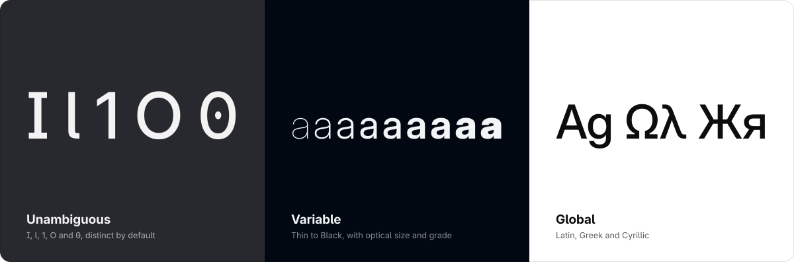

<div align="center">
  <picture>
    <source media="(prefers-color-scheme: dark)" srcset="assets/wordmark-dark.svg" />
    
  </picture>

  <p><strong>The typeface of Wave: a variable sans serif for screens,<br />precise at small sizes, refined at large ones, and unambiguous in every name.</strong></p>

  [](https://www.npmjs.com/package/@waveso/sans)
  [](./LICENSE.txt)
  

  <br />

  
</div>

---

## Why Wave Sans

A typeface for a social product has three jobs: set every name so it reads
one way, keep dense interface text clear at small sizes, and look the same
in light and dark themes. Wave Sans is built for all three.

- **Unambiguous.** The capital I has serifs, the lowercase l a tail and the
  zero a dot, by default. I, l and 1 never look alike, nor do O and 0, so a
  username reads exactly as it was written. The plain forms are one line of
  CSS away.
- **Made for screens.** A tall x-height, open shapes and even spacing keep
  text clear from 11 px. Optical size follows the font size on its own:
  sturdier and more open for text, finer and tighter for headlines.
- **Steady in every theme.** Grade changes stroke weight without changing a
  single width. Lighten text on dark backgrounds so it matches its weight on
  light ones, or strengthen a selected tab, and nothing on the page moves.
- **Global.** Over 2,100 characters across Latin, Greek and Cyrillic, from
  Vietnamese and Yoruba to polytonic Greek.
- **Light on the web.** The web fonts come in eleven files by character set,
  and a browser downloads only the ones a page uses: about 140 KB for
  English.
- **Complete.** A continuous weight range from Thin to Black, tabular and
  case-sensitive forms, fractions, and a full set of stylistic sets and
  character variants.
- **Open.** The SIL Open Font License, editable sources, and a build anyone
  can rerun and verify.

## Installation

```bash
pnpm add @waveso/sans
```

## Usage

Import the stylesheet once, in your app's entry file or root layout, and set
the family:

```js
import '@waveso/sans';
```

```css
body {
  font-family: "Wave Sans", system-ui, sans-serif;
}
```

Without a bundler, serve the web fonts folder and link its stylesheet.
Preloading the Latin file avoids a flash of fallback text:

```html
<link rel="preload" href="/fonts/WaveSans-latin.woff2" as="font" type="font/woff2" crossorigin>
<link rel="stylesheet" href="/fonts/wave-sans.css">
```

### Light and dark

Light text on a dark background looks heavier than dark text on a light one.
Lower the grade in dark themes, and raise it for selected and hovered
states. Widths never change, so nothing reflows.

```css
.dark { font-variation-settings: "GRAD" -25; }
[aria-selected="true"] { font-variation-settings: "GRAD" 100; }
```

`font-variation-settings` replaces the value an element inherits instead of
adding to it, so set every axis you need in the same declaration.

### Plain forms

`ss09` gives back the plain I and l, and `ss10` the plain zero:

```css
.plain { font-feature-settings: "ss09", "ss10"; }
```

## Axes

| Axis | Range | Default | Set with |
|---|---|---|---|
| Weight `wght` | 100 to 900 | 400 | `font-weight` |
| Optical size `opsz` | 14 to 32 | the font size | `font-optical-sizing: auto` |
| Grade `GRAD` | −50 to +100 | 0 | `font-variation-settings` |

Grade is measured in weight units: at +100, strokes are as heavy as a weight
100 higher, at the same width.

## Features

| Feature | CSS |
|---|---|
| Tabular figures | `font-variant-numeric: tabular-nums` |
| Fractions | `font-variant-numeric: diagonal-fractions` |
| Slashed zero | `font-variant-numeric: slashed-zero` |
| Superscripts and subscripts | `font-variant-position: super` and `sub` |
| Case-sensitive forms | `font-feature-settings: "case"` |
| Plain I and l | `font-feature-settings: "ss09"` |
| Plain zero | `font-feature-settings: "ss10"` |
| Open digits | `font-feature-settings: "ss01"` |
| Round quotes and commas | `font-feature-settings: "ss03"` |
| Circled and squared characters | `font-feature-settings: "ss05"` and `"ss06"` |
| Square punctuation and quotes | `font-feature-settings: "ss07"` and `"ss08"` |
| Alternate one | `font-feature-settings: "cv01"` |
| Open four, six and nine | `font-feature-settings: "cv02"`, `"cv03"` and `"cv04"` |
| Flat-top three | `font-feature-settings: "cv09"` |
| Simplified u | `font-feature-settings: "cv06"` |
| Single-storey a | `font-feature-settings: "cv11"` |
| Capital G with spur | `font-feature-settings: "cv10"` |
| Compact f and t | `font-feature-settings: "cv12"` and `"cv13"` |
| Alternate ß and ẞ | `font-feature-settings: "cv07"` and `"cv14"` |

## Files

`make build` writes the fonts to `build/fonts/`:

| File | What it is |
|---|---|
| `var/WaveSans[GRAD,opsz,wght].ttf` | The variable font, for apps and design tools |
| `web/wave-sans.css`, `web/WaveSans-*.woff2` | The web fonts in eleven files by character set, and the stylesheet that loads them |
| `web/WaveSans.woff2` | The whole font in one file, for setups that do not split by character |

Every file has all three axes and every OpenType feature. An English page
loads only `WaveSans-latin.woff2`, about 140 KB. A Polish page adds
`latin-ext`, about 70 KB; a Russian page needs `cyrillic`, plus `latin` for
digits and punctuation.

## Specimen

[specimen/index.html](specimen/index.html) shows the font at work: names,
grade, sizes and weights, languages with the files each one loads, features
and every character.

```bash
make specimen   # served at http://localhost:8000
```

Browsers do not load fonts from a page opened as a file, so the page is
served. `build/specimen` is the whole site: any web server can host it.

## Development

Building needs Python 3 and make.

```bash
make venv       # Python environment from requirements.txt
make build      # the variable font and the web fonts
make verify     # compare the build with the upstream release, glyph by glyph
make qa         # FontBakery's checks and the confusable-pairs benchmark
make upstream   # the upstream release that verify and qa compare against
make specimen   # the specimen, at http://localhost:8000
make package    # the npm package, in build/package
make assets     # the README images, drawn from the font
```

The history starts from the upstream sources, untouched, and every later
commit is one reviewed change. `make verify` compares every outline,
advance and kerning pair with the upstream release and fails on any
difference it cannot explain: each intended change is listed in
`tools/verify.py` with its reason. The first run downloads the release it
compares against, Inter v4.1, into `upstream/inter-release/` and checks its
checksum.

`make qa` runs FontBakery's universal checks and fails on any change from
the problems recorded in `tools/qa-known.json`, where `tools/qa.py` gives
each one's reason. It then measures how alike confusable pairs look at 11
to 16 px on 1x and 2x screens: I l 1, O 0 o, rn m, cl d and vv w.

`tools/proof.py` sets the same lines side by side in several font setups,
for review images.

CI builds, verifies and checks every push and pull request, and keeps each
run's fonts for download.

### Project structure

```
.github/       CI, and publishing to npm
assets/        README images, drawn from the font
misc/tools/    upstream build scripts the build uses
package/       npm package manifest and readme
specimen/      the specimen page
src/           font sources: Glyphs 3 packages and OpenType feature files
tools/         build, verification, QA, web fonts, package and images
upstream/      upstream checkout and release, for verification (not in git)
```

## Releasing

Releases are published from GitHub. The font's version is in `version.txt`:
0.1 for the previews, until the first stable release, 1.0. To release,
change it and the version in `package/package.json` together (version 0.1
is package 0.1.x, where the last number counts releases of the same font),
and date the version's entries in FONTLOG.txt.

When that change reaches main, the Publish workflow builds, verifies and
checks the fonts, publishes `@waveso/sans` to npm, and creates the GitHub
release with the fonts and the version's FONTLOG entries. A version already
on npm is not published again.

Publishing uses npm's trusted publishing, so no token is stored. It takes
three steps, once:

1. Publish the first version by hand: `make build verify qa package`, then
   `pnpm publish build/package`.
2. On npmjs.com, give `@waveso/sans` a trusted publisher: owner
   `wavedotso`, repository `wave-sans`, workflow `publish.yml`.
3. Run the Publish workflow from the Actions tab, which creates the first
   version's GitHub release.

## License

[SIL Open Font License 1.1](LICENSE.txt). “Wave Sans” is a Reserved Font
Name: a modified version must be published under another name.
[FONTLOG.txt](FONTLOG.txt) records every change.
